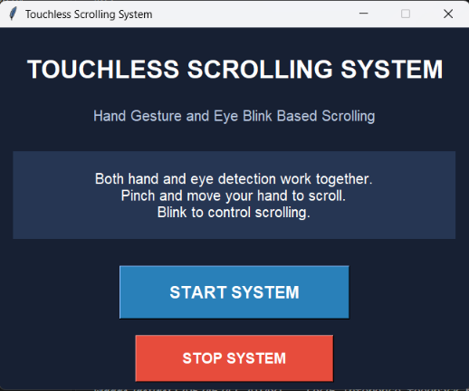

# Touchless Scrolling System

## Project Overview
The Touchless Scrolling System is a Python-based application that allows users to control computer scrolling without touching a mouse.

It combines hand gesture recognition and eye blink detection using computer vision.

## Technologies Used
- Python
- OpenCV
- MediaPipe
- PyAutoGUI
- Tkinter

## Features
- Hand landmark detection
- Pinch gesture recognition
- Eye blink detection
- Hand gesture-based scrolling
- Eye blink-based scrolling
- Combined hand and eye control
- ## Project Dashboard



## Project Files
- main_dashboard.py
- touchless_scroll.py
- eye_scroll.py
- eye_detection.py
- hand_detection.py
- pinch_detection.py
- main.py
- requirements.txt

## Installation

Install the dependencies:

```bash
pip install -r requirements.txt
```

## Run the Application

```bash
python main_dashboard.py
```

## How It Works
1. Start the application.
2. Allow webcam access.
3. Pinch and move your hand to scroll.
4. Use detected eye blinks to control scrolling.

## Future Enhancements
- Improved detection accuracy
- Better scrolling controls
- Enhanced dashboard design
- Improved accessibility

## Developer
Pushpa Charitha

## License
For educational purposes.
